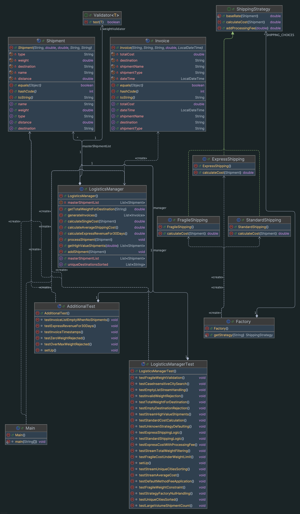

# The Atlas Logistics Optimisation System Report

- [Introduction](#1-introduction)
- [Project Structure](#2-project-structure)
- [What was implemented](#3-what-was-implemented)
- [Functional Programming](#4-functional-programming)
- [Testing](#5-testing)
- [UML Diagrams](#6-uml-diagrams)
- [Conclusion](#7-conclusion)

---

## 1. Introduction
`Atlas` is a centralised logistics management system designed for shipment processing and fleet auditing.
For this project, was used Java 25+ and the Gradle build system. Other thechnologies used include:
- **Project Lombok**: To reduce boilerplate code and enhance readability.
- **JUnit 5**: For unit testing to ensure code reliability and correctness.
- **IntelliJ IDEA**: As the primary IDE for development.
- **Git**: For version control.
- **UML Diagrams via IntelliJ**: To visually represent the system architecture and design.

---

## 2. Project Structure

The project follow a modular structure, with clear separation of concerns. The main components are organized as follows:
```
src/main/java/com/atlas/
├── core/
│     └── LogisticsManager.java
├── interfaces/
│   ├── ShippingStrategy.java
│   └── Validator.java
│ 
├── models/
│   ├── Shipment.java
│   └── Invoice.java
│ 
├── strategies/
│   ├── StandardShipping.java
│   ├── ExpressShipping.java
│   ├── FragileShipping.java
│   └── Factory.java
└── Main.java
src/test/java/com/atlas/
├── LogisticsManagerTest.java
└── AdditionalTest.java
```

- `core`: Contains the main logic for managing logistics operations.
- `interfaces`: defines the contracts for shipping strategies and validation.
- `models`: Contains the data models for shipments and invoices.
- `strategies`: Contains the implementations of different shipping strategies and a factory returns the correct strategy 
based on input.
- `Main.java`: The entry point of the application where the simulation is executed.
- `src/test`: Contains unit tests.

---

## 3. What Was Implemented
The project implements the following design patterns:

**Strategy Pattern** — 3 shipping strategies implement the `ShippingStrategy` interface. `StandardShipping` returns the 
base rate, `ExpressShipping` multiplies by 1.75 and adds a £5 processing fee using the `addProcessingFee()` method, and 
`FragileShipping` applies a 1.2 × multiplier plus a £20 surcharge. The `Factory` class uses an `Map.of(...)` to pick the
correct strategy from a type string. If type is unknow it should return a `StandardShipping` strategy as default.

**Models**  Shipment and Invoice models use Lombok @Value for generating constructors, getters, equals(),
and toString() and others automatically.

**Validation** — The `Validator`<T> extends Predicate<T>, enabling 3 lambda-based rules (weight between 0–1000 kg, 
destination not null nad not empty, fragile items <= 50 kg) to be composed with and() into a single validation in 
processShipment(). Invalid shipments throw IllegalArgumentException.

**Output** — in the `Main' was implemented Invoice output with details of the shipment, cost, strategy used, and date.

## 4. Functional Programming

All data processing in `LogisticsManager` uses Java Streams and Lambdas.

- `getTotalWeightForDestination()` filters shipments by city using `equalsIgnoreCase` for case sensitivity 
and sums weights with `mapToDouble` and `sum()`.

- `getTotalWeightForDestination()` filters shipments by city using `equalsIgnoreCase` for case-insensitive matching, 
then uses `mapToDouble` and `sum` to aggregate weight.

- `getUniqueDestinationsSorted()` chains `map`, `distinct`, `sorted`, and `toList()` to produce an alphabetically 
ordered list of unique cities.

- `getHighValueShipments()` filters shipments where `calculateSingleCost()` exceeds a threshold. The result is collected
into a list.

- `calculateAverageShippingCost()` maps each shipment to its cost via `mapToDouble` then calls `average()`. It handles 
the empty list case with `orElse(0)`.

- `generateInvoices()` transforms each `Shipment` into an `Invoice` using `map`. Also adding the calculated cost and 
a `LocalDateTime.now()` timestamp.

- `calculateExpressRevenueFor30Days()` — This method uses `Invoice` objects as it needs a 30 day time window. 
In `Invoice` was added `dateTime`, so it made easy to generate invoices first, then filter by type and date, and sum 
the costs. The cost calculation is the same because it goes through the same Strategy logic.

- The Validator lambdas also follow a functional approach. Each rule is a lambda that extends `Predicate<T>`, so instead 
of multiple`if-else` blocks they are chained together with `and()`.
- 
---

## 5. Testing
Unit tests are implemented using JUnit 5 in `LogisticsManagerTest.java` and `AdditionalTest.java`.
- All **21 provided tests** in `LogisticsManagerTest` pass, covering strategy cost calculations, stream pipelines, 
validation rejection, edge cases, and the default method fee.

- **5 additional tests** were added in `AdditionalTest`:

| Test | What It Checks                                              |
|------|-------------------------------------------------------------|
| `testInvoiceListEmptyWhenNoShipments()` | returns empty list when no shipments exist, without returning null. |
| `testExpressRevenueFor30Days()` | return positive revenue when Express shipments are present. |
| `testInvoiceTimestamps()` | Checks that every invoice has a date within the last 30 days. |
| `testZeroWeightRejected()` | Shipment with weight 0.0 throws `IllegalArgumentException`, weight must be > 0. |
| `testOverMaxWeightRejected()` | Shipment with weight 1000.1 throws `IllegalArgumentException`, as weight >= 1000 kg.|

All **26 tests pass** with no failures.

---

## 6. UML Diagrams
The UML class diagram was generated using IntelliJ IDEA's built-in diagram tool. It shows all 10 classes and interfaces 
with their fields, methods, visibility, and return types.


---

## 7. Conclusion
The Atlas Logistics Optimisation System was successfully implemented with a modular structure. The Atlas project was 
built using Java 25+ and Gradle. The Strategy pattern was used to handle different shipping cost calculations. 
The Factory pattern picks the right strategy based on the shipment type. Data processing was done using Java Streams and
Lambdas. To keep the system safe and consistent fragile weight ambiguity was done by rejecting overweight shipments 
during validation. All 26 tests pass.

---